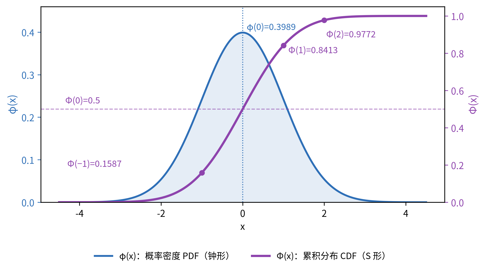
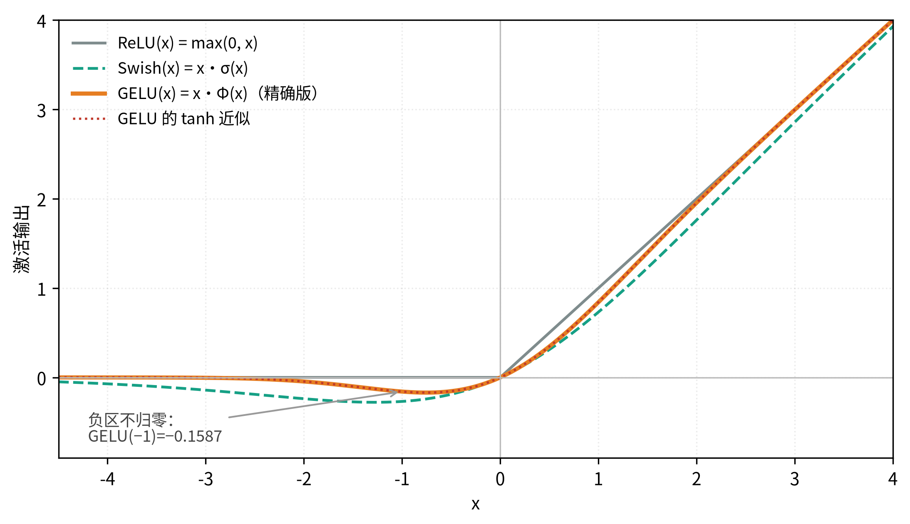
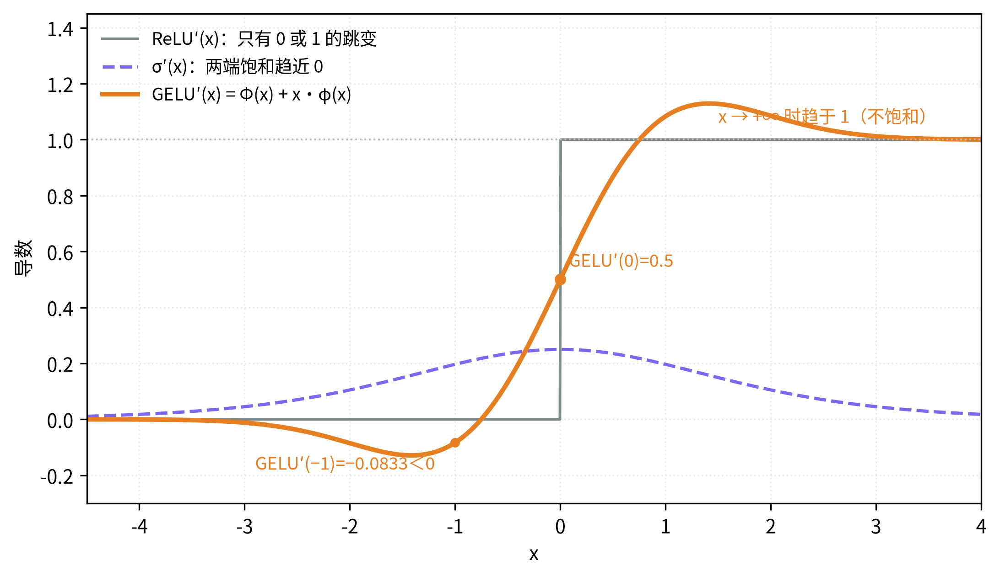
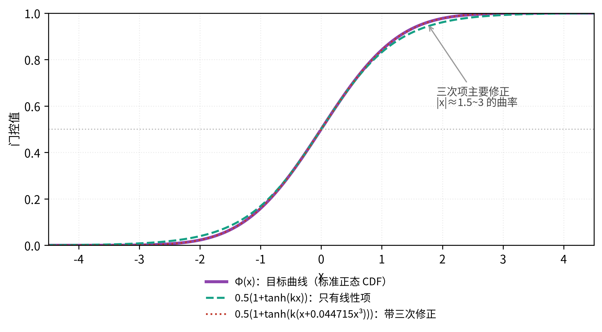
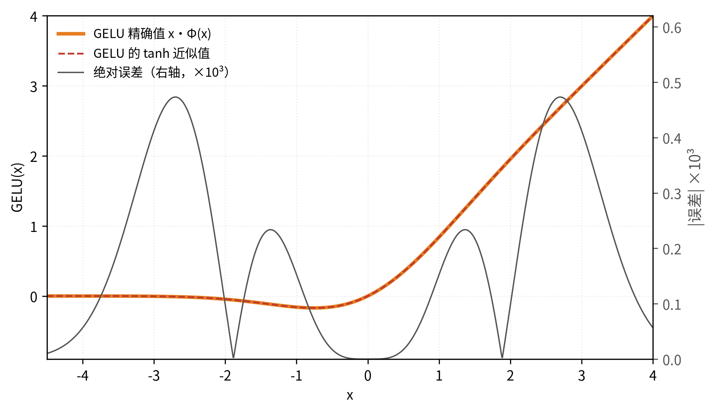

# 17 深度解析 `test/test_06_gelu.c`：GELU 与高斯门控

> 顺着 `test_06_gelu.c` 的断言，把 GELU 从概率来源一路拆到 `c/activations.c` 的那 6 行代码。

## 0. 这篇文档要解决什么

`test/test_06_gelu.c` 只有 87 行，但它压着两个魔数和一个反直觉的公式：

```c
float c = 0.7978845608f;  // sqrt(2/π)
float b = 0.044715f;
return 0.5f * x * (1.0f + tanhf(c * (x + b * x * x * x)));
```

读完 `04-MLP.md` 你知道「GELU = x 乘一个 S 形的门」，但仍然答不出：

| 读者会卡住的问题 | 本文对应小节 |
|---|---|
| `Φ(x)` 为什么是正态累积分布，而不是别的 S 形？ | 第 2 节 |
| `0.7978845608` 这个魔数怎么来的？ | 第 6 节 |
| `0.044715` 是什么？为什么不是别的数？ | 第 6 节 |
| 三次项为什么只能是 `x³`，不能有 `x²`？ | 第 6 节 |
| 「负数不死」到底是不是真的？ | 第 5 节 |
| 为什么测试容差是 `0.01` 而不是 `1e-6`？ | 第 8 节 |

**前置知识**：一元积分与求导、正态分布的基本定义、反向传播中「梯度逐层相乘」的直觉。全文默认标准正态（均值 0、方差 1）。

---

## 1. 起点：GELU 究竟在算什么

### 1.1 一行定义

```text
GELU(x) = x * Phi(x)
```

其中 `Phi(x)` 是标准正态分布的**累积分布函数**（CDF）。GELU 没有引入新的概率模型，它只是把「把输入保留多少」这件事，交给了一个由正态分布决定的概率值。

### 1.2 随机门控：为什么是 Φ

设想一个独立于 `x` 的标准正态随机变量 `Z ~ N(0, 1)`，按下面规则产生输出：

- 当 `Z <= x` 时，原样放过 `x`
- 当 `Z > x` 时，输出 0

写成指示函数形式：

```text
Y = x * 1{Z <= x}        # 1{·} 表示条件成立取 1，不成立取 0
```

`Z <= x` 的概率是 `Phi(x)`，置零的概率是 `1 - Phi(x)`。取数学期望：

```text
E[Y] = x * P(Z <= x) + 0 * P(Z > x)
     = x * Phi(x)
     = GELU(x)
```

这一步说明三件事：

1. `Phi(x)` 在这里的角色是「**门开的概率**」；
2. `x * Phi(x)` 是「概率 × 开启时的取值」的加权平均，所以它是**期望值**；
3. GELU 在训练时**并不真的去采样**，而是直接取这个期望，所以它是确定性的、光滑的、可导的——随机性只存在于推导过程中，不在前向计算里。

对比一下：如果每次真的按概率采样，那就是 dropout 式的随机行为，同一个 `x` 会时而出 `x`、时而输出 0。GELU 取期望，同一个 `x` 永远得到同一个确定值。

### 1.3 四个最常见的误解

| 常见说法 | 实际情况 |
|---|---|
| `Phi(x)` 的取值范围是 −1 到 1 | 值域是开区间 (0, 1)，定义域是全体实数。`Phi(2) ≈ 0.9772`，`Phi(-2) ≈ 0.0228` |
| `Phi(x)` 需要 softmax 才能得到概率 | 不需要。softmax 是同一向量内多个元素相互竞争、总和为 1 的归一化；`Phi` 是单变量的累积概率，与其它元素无关 |
| GELU 的输出是一个概率 | 不是。`x * Phi(x)` 可正可负、可超过 1（`GELU(2) = 1.9545`），它只是随机门控的期望值 |
| `Phi(x)` 的曲线形状可以随数据变化 | 标准正态固定了 `mu=0, sigma=1`，`phi` 与 `Phi` 都被唯一确定。能平移、能变陡的是 `N(mu, sigma^2)` 的分布函数，不叫 `Phi` |

记忆对照：**`Phi` 是「累积出来的概率」，`phi`（小写）是「它的导数，也就是密度」**。

---

## 2. Φ 从哪里来：从钟形到累积

`Phi` 本身不能「再推导」——它的定义就是密度的积分。所以真正要推的是**钟形密度**，以及那个 `sqrt(2*pi)` 系数怎么冒出来的。

### 2.1 为什么是指数平方形式

历史上，这条曲线是从二项分布逼近出来的。抛一枚均匀硬币 n 次，正面次数 `X` 服从二项分布；当 n 增大时，概率直方图会被一条光滑曲线包住，这条曲线有三个特征：

- 关于中心对称
- 处处光滑
- 两端迅速衰减到 0

满足这三点的最简形式就是：

```text
f(t) = C * exp(-a * t^2)
```

`C` 是待定系数，`a` 决定曲线的胖瘦。中心极限定理后来给出了更普遍的解释：大量独立同分布的小扰动叠加，其和的标准形态就趋于这个形状。

### 2.2 归一化：泊松积分与 `sqrt(2*pi)` 的来历

概率密度要求整条曲线下的总面积等于 1。先算不带系数的积分：

```text
I = ∫(-∞, +∞) exp(-a*t^2) dt
```

这个积分没有初等原函数，经典做法是**把它平方，转成二重积分再用极坐标**：

```text
I^2 = ∬(R^2) exp(-a*(t^2 + s^2)) dt ds

令 t = r*cosθ, s = r*sinθ
面积元 dt ds = r dr dθ

I^2 = ∫(0, 2π) ∫(0, +∞) exp(-a*r^2) * r dr dθ
```

内层换元 `u = a*r^2`，`du = 2*a*r dr`，得 `1/(2a)`；外层对 `θ` 积分得 `2π`。因此：

```text
I^2 = π / a
I   = sqrt(π / a)
```

现在施加「标准正态」的约束：方差为 1，对应 `a = 1/2`，此时 `I = sqrt(2π)`。要让总面积等于 1，前面的系数必须取倒数：

```text
phi(t) = (1 / sqrt(2π)) * exp(-t^2 / 2)
```

**这就是 `1/sqrt(2π) ≈ 0.3989` 的全部来历**——它不是约定的魔法常数，而是为了保证「总面积等于 1」算出的归一化因子。图 1 左轴那个钟形的峰值 `phi(0) = 0.3989` 就是它。

### 2.3 从密度到累积：Φ 与 erf 的换算

有了密度，累积分布就是把它从最左端一直积到 `x`：

```text
Phi(x) = ∫(-∞, x) phi(t) dt
```

同样没有初等原函数。数值计算中通常借助误差函数：

```text
erf(z) = (2/sqrt(π)) * ∫(0, z) exp(-s^2) ds
```

两者只差一个线性变换：

```text
Phi(x) = 0.5 * [1 + erf(x / sqrt(2))]
```

> **本仓库注意**：`c/activations.c` 用的是 **tanh 近似**，不是 `erf`。所以 `test_06_gelu.c` 的期望值是精确值，被测函数是近似值，两者天然存在 `1e-4` 量级的差——这就是容差 0.01 的根源，详见第 8 节。



---

## 3. 密度与累积：导数与积分的关系

### 3.1 累积分布的导数就是密度

按定义，`Phi(x)` 是「从 `-∞` 积到 `x` 的总概率」。由微积分基本定理：

```text
Phi'(x) = phi(x)
```

含义是：**密度的数值 = 累积概率在该点的变化率**。`phi(x)` 越大，说明这个位置附近概率堆得越快，`Phi` 的曲线越陡；`phi(x)` 越小，`Phi` 越平缓。

把 `Phi` 理解为「已经攒了多少概率」，把 `phi` 理解为「当前攒的速度」，两者一一对应。这也是图 1 里两条曲线的关系：蓝钟形的高度，正好是紫 S 形的斜率。

### 3.2 密度本身不是概率

连续分布下，某个**单点的概率为零**，只有区间才有概率：

```text
P(a < X <= b) = ∫(a, b) phi(t) dt
```

即 `phi(x)` 只是「单位长度上的概率浓度」，类似物理里的线密度。**密度可以大于 1**（区间足够窄时），而概率永远不超过 1。把 `phi(x)` 直接当成「`x` 这一点的概率」，是最常见的概念错误。

### 3.3 四条稳定性质

1. 严格单调递增
2. 值域为 (0, 1)
3. 关于点 `(0, 0.5)` 中心对称，即 `Phi(-x) = 1 - Phi(x)`
4. 在 `x = 0` 处斜率最大，等于 `phi(0) ≈ 0.3989`

第 4 条尤其重要：因为标准正态参数固定，`phi` 与 `Phi` 都是**唯一确定的一条曲线**，不随数据变化。正因为形状固定，我们才有可能用一组常数一次性拟合它——**这是第 6 节 tanh 近似能够成立的前提**。

### 3.4 关键点取值表

| `x` | `phi(x)`（密度） | `Phi(x)`（累积概率） | `GELU(x) = x · Phi(x)` |
|---|---|---|---|
| −3 | 0.0044 | 0.0013 | −0.0040 |
| −2 | 0.0540 | 0.0228 | −0.0455 |
| −1 | 0.2420 | 0.1587 | −0.1587 |
| 0 | 0.3989 | 0.5000 | 0.0000 |
| 1 | 0.2420 | 0.8413 | 0.8413 |
| 2 | 0.0540 | 0.9772 | 1.9545 |
| 3 | 0.0044 | 0.9987 | 2.9960 |

从这张表可以直接读出 `test_06_gelu.c:40` 那行期望值的来源：

- `x = -1` 时门只开 15.87%，期望是 `-0.1587`
- `x = 1` 时期望 `0.8413`
- `x = 2` 时期望 `1.9545`——**已经明显超过 1，说明输出根本不是概率**

---

## 4. GELU 的解析性质：导数与两侧极限

### 4.1 用乘积法则求导

GELU 是两个函数的乘积：`x` 和 `Phi(x)`。按乘积法则 `(u*v)' = u'*v + u*v'`：

```text
GELU'(x) = 1 * Phi(x) + x * phi(x)
         = Phi(x) + x * phi(x)
```

两项各有含义：

| 项 | 物理含义 |
|---|---|
| `Phi(x)` | 「门当前的位置」——即使门不动，输入本身带来的那段斜率 |
| `x * phi(x)` | 「门自己还在移动」带来的附加斜率，因为 `phi` 是门的变化速度 |

### 4.2 `x` 很大时为什么梯度趋于 1

当 `x` 往正无穷走，累积面积把几乎整条钟形都包了进来，`Phi(x)` 趋于 1；与此同时

```text
phi(x) = exp(-x^2/2) / sqrt(2π)
```

以**指数速度**塌缩，哪怕乘上一个 `x`，`x * phi(x)` 也趋于 0。于是 `GELU'(x)` 整体趋于 1。

### 4.3 为什么这一点胜过 sigmoid

`sigmoid` 满足 `σ(x) = 1/(1 + exp(-x))`，导数是 `σ(x) * [1 - σ(x)]`。

当 `x` 很大时 `σ → 1`，导数的两个因子分别趋于 `1` 和 `0`，乘积趋于 0——**函数值卡在 1 附近，梯度却消失了**。这就是**饱和**（saturate）。

两者都「平滑」，但一个不饱和、一个饱和：**平滑从来不等于好用**。

### 4.4 负半轴：不立即归零，也不是永不死亡

当 `x` 往负无穷走，`Phi(x) → 0`，`x * phi(x) → 0`，梯度也趋于 0。但在常用区间里情形完全不同：

```text
GELU(-1)  = -0.1587
GELU'(-1) = Phi(-1) + (-1) * phi(-1)
          = 0.1587 - 0.2420
          = -0.0833        # 仍然是一个不为零的负梯度
```

输入越负，梯度越接近 0，但**不会像 ReLU 那样在 `x < 0` 的整段区间恒等于 0**。

所以更准确的说法是：

> GELU 在 `|x|` 小于约 3 的区间内保留了负半轴的梯度，从而显著缓解神经元死亡；真正深度负区间它同样趋于平坦。
>
> 把它说成「负数永不死亡」是**过度简化**。

### 4.5 零点处的光滑过渡

```text
GELU'(0) = Phi(0) + 0 * phi(0) = 0.5
```

左右导数一致，函数在原点连续可导。而 ReLU 在 0 点的导数由 0 直接跳到 1，是一个**折角**，优化器在尖点附近容易出现梯度震荡。

### 4.6 导数的峰值

数值扫描（步长 `1e-4`）得到：

```text
max GELU'(x) = 1.1289   at x = 1.414
```

即导数在 `x ≈ 1.41` 附近**略微超过 1**，然后从上方缓慢回落并趋于 1。这意味着小正值区在训练早期能获得稍强的更新，而远离原点后不会持续累积放大。





图 3 是本章结论的可视化：

- **`σ'(x)`**（紫虚线）在两侧都被压到 0——饱和
- **`ReLU'(x)`**（灰实线）是一条 0/1 的断崖
- **`GELU'(x)`**（橙实线）是一条光滑曲线，在 `x ≈ 1.41` 略超 1，然后回落趋于 1；在 `x ≈ -1` 处仍有 `-0.0833` 的负值

---

## 5. tanh 近似：`activations.c` 那一大坨是怎么来的

### 5.1 tanh 与 sigmoid 是一回事

`tanh` 是双曲正切，值域 `(-1, 1)`，奇函数，处处光滑：

```text
tanh(z) = (exp(z) - exp(-z)) / (exp(z) + exp(-z))
```

它和 sigmoid 之间有恒等关系：

```text
σ(z) = 0.5 * [1 + tanh(z/2)]
```

反过来，把 `tanh` 的输出抬到 0 到 1 之间，就得到一个 sigmoid 形的门。**所以近似公式里的 `0.5 * (1 + tanh(...))` 这一整块，本质就是一个 sigmoid 门**，只不过喂给它的输入经过了改造。

### 5.2 喂给 tanh 的 `z` 分成三部分

```text
GELU(x) ≈ 0.5 * x * [1 + tanh( sqrt(2/π) * (x + 0.044715 * x^3) )]
                          └────┬────┘    └──┬──┘   └─────┬─────┘
                             全局缩放        主项        三次修正
```

**第一部分：`x`（主项）**

保证门在原点附近近似线性上升，中心落在 0.5，与 `Phi(0) = 0.5` 对齐。

**第二部分：`0.044715 * x³`（三次修正项）**

奇次的三次项。它在 `|x|` 较小时几乎不起作用，一旦 `|x|` 增大到 1~3，就开始改变 S 曲线的弯曲速度，把尾部推得更贴合 `Phi`。这个常数**不是从某个理论精确推出的，而是拟合中调出来的最优值**。

**第三部分：`sqrt(2/π) ≈ 0.7978845608`（全局缩放系数）**

这是 `c/activations.c:16` 那个魔数的来源。推导只有两步：

```text
(1) 近似式在 x = 0 处的导数：
    0.5 * (1 + tanh(k*x))  =>  导数 = k/2

(2) 目标函数在 x = 0 处的导数：
    Phi'(0) = phi(0) = 1 / sqrt(2π)

(3) 令两者相等：
    k/2 = 1 / sqrt(2π)
    k   = 2 / sqrt(2π)
        = sqrt(2/π)
        ≈ 0.7978845608
```

**系数就是这么定的——用原点斜率对齐。**

### 5.3 为什么多项式只能用奇次项

因为目标是 `Phi`，而 `Phi` 具有中心对称性：

```text
Phi(-x) = 1 - Phi(x)
```

把等号两边都减去 0.5，得到 `Phi(x) - 0.5` **关于原点奇对称**。

近似式的外壳 `0.5 * (1 + tanh(z))` 中，`tanh` 本身是奇函数，常数 0.5 提供平移。因此**只要 `z` 是 `x` 的奇函数，整体就自动继承这个对称性**。

这就是为什么只能出现 `x`、`x³`、`x⁵` 这类奇次项。若加入 `a*x²` 这样的偶次项：

```text
g(-x) = 0.5 * [1 + tanh(k * (-x + a*x^2))]
而 1 - g(x) = 0.5 * [1 - tanh(k * (x + a*x^2))]
两者不再相等
```

`x = 1` 和 `x = -1` 两点会**同时偏高或偏低**，尾部误差立刻放大。

> **结论：约束来自目标函数的对称性，而不是拟合经验。**

### 5.4 三次项究竟修正了什么



- **紫实线**：目标 `Phi(x)`
- **绿虚线**：只有线性项 `0.5*(1+tanh(k*x))`，在 `|x|` 约 1.5~3 这一段明显偏低或偏高
- **红点线**：带三次修正，这一段曲率被拉回，与紫线几乎重合

三次项不是「让函数更复杂」，而是**专门去补那一段误差**。

### 5.5 误差量级与适用边界

对 `[-8, 8]` 以 `1e-4` 步长扫描，**实测最大绝对误差 `4.73e-4`，出现在 `x ≈ -2.70`**（相对量级 `1e-3`）。

| 区间 | 主导项 | 表现 | 与精确值的偏差 |
|---|---|---|---|
| `|x| < 0.8` | 线性项 `x` | 门近似线性，中心在 0.5 | 极小，量级 `1e-5` 以下 |
| `0.8 ~ 3` | 三次项开始起效 | 修正尾部曲率，贴合 `Phi` | 峰值 `≈ 4.7e-4` |
| `|x| > 3` | 三次项主导 | 快速饱和到 0 或 1，GELU 近似 ReLU | 指数级下降 |



图 5 右轴是误差曲线（单位 `×10^-3`），可以看到它在两侧呈**振荡衰减**：绝对值越大，误差越小。

### 5.6 为什么不直接用 erf

道理在硬件上：

| 实现 | 代价 | 精度 |
|---|---|---|
| `erf` | 分段有理逼近或查表，延迟高、向量化差 | 机器精度量级 |
| `tanh` | GPU 与常见加速库有专门的高吞吐实现 | 最大误差 `4.7e-4` |

近似式只是把「一次立方 + 一次加法」加进已有的乘法链，**代价几乎可以忽略**，却把一条原本需要特殊函数的曲线，换成了纯初等运算。

至于 `1e-3` 的精度损失，在激活函数这个环节基本无感：真正影响训练的是**曲线的整体形状与梯度分布**，而不是第四位小数。

---

## 6. 为什么需要 GELU：激活函数的演进逻辑

把 GELU 放进历史序列，它的存在理由就清楚了——**它是为了解决前几代激活函数的具体缺陷**。

### 6.1 sigmoid 与 tanh 的问题不在「不光滑」

这两者都是处处光滑的，问题出在**饱和**。输入绝对值稍大，sigmoid 输出贴近 0 或 1，导数 `σ(1-σ)` 趋近 0；tanh 同样在两端把导数压平。反向传播时梯度逐层相乘，每经过一层就再衰减一次，深层网络因此训不动。

另一个问题是 sigmoid 输出恒为正、均值不为零。下一层输入全为正数，会导致权重梯度长期同号，优化路径呈锯齿状。tanh 输出零均值解决了这条，但饱和问题依旧。

### 6.2 ReLU 解决了饱和，但带来两处硬伤

`ReLU(x) = max(0, x)` 正半轴梯度恒为 1，一举缓解梯度消失，而且计算极便宜，迅速成为主流。但代价明确：

1. **神经元死亡**——输入长期落在负区间，输出和梯度都恒为 0，参数永远不再更新
2. **0 点折角**——导数从 0 直接跳到 1，不连续，优化器在尖点附近容易震荡
3. **负区信息整段丢弃**——而一些负向信号其实携带有用信息

### 6.3 GELU 与 Swish 是同一个思路

两者的结构都是「**输入 × 一个平滑的 0 到 1 门**」：

- 正半轴维持接近 ReLU 的行为（梯度趋于 1）
- 负半轴不硬截断（保留少量输出与梯度）
- 整条曲线连续可导

区别只在于门用什么函数：

| 激活函数 | 门 | 来源 |
|---|---|---|
| Swish | `σ(x)` | 人为挑选的 S 形 |
| GELU | `Phi(x)` | 随机门控的统计期望 |

这也是为什么在 BERT、GPT 早期版本上 GELU 表现更稳定一些。

### 6.4 五种激活函数的取舍对照

| 激活函数 | 光滑性 | `x→+∞` 梯度 | 负区行为 | 主要问题 |
|---|---|---|---|---|
| sigmoid | 无穷阶可导 | 趋近 0（饱和） | 输出恒正、均值非零 | 梯度消失、收敛慢 |
| tanh | 无穷阶可导 | 趋近 0（饱和） | 零均值 | 两端饱和依旧 |
| ReLU | 0 点不可导 | 恒为 1 | 整段归零，梯度 0 | 神经元死亡、折角 |
| Swish `x·σ(x)` | 无穷阶可导 | 趋近 1 | 保留微弱负输出 | 门控形状缺乏统计来源 |
| **GELU `x·Φ(x)`** | **无穷阶可导** | **趋近 1** | **保留微弱负输出，最小值约 −0.17** | 原版需 `erf`，工程上用近似 |

---

## 7. 落到本项目代码

### 7.1 实现：`c/activations.c:15-20`

```c
static inline float gelu(float x) {
    float c = 0.7978845608f;  // sqrt(2/π)
    float b = 0.044715f;
    float inner = c * (x + b * x * x * x);
    return 0.5f * x * (1.0f + tanhf(inner));
}
```

逐行对应第 5 节的拆解：

| 代码 | 数学 | 出处 |
|---|---|---|
| `c = 0.7978845608f` | `sqrt(2/π)` | 5.2 节，由原点斜率对齐推出 |
| `b = 0.044715f` | 三次项系数 | 5.2 节，拟合值 |
| `x + b*x*x*x` | `x + 0.044715*x³` | 5.2 节，奇次项约束见 5.3 |
| `0.5f * x * (1 + tanhf(inner))` | `0.5*x*(1 + tanh(z))` | 5.1 节，即 `x * sigmoid(z)` |

### 7.2 向量化封装：`c/activations.c:22-26`

```c
void gelu_forward(float* out, const float* inp, int N) {
    for (int i = 0; i < N; i++) {
        out[i] = gelu(inp[i]);
    }
}
```

逐元素独立运算，**不涉及 token 之间或 batch 之间的交互**——这是激活函数与 Attention 最本质的区别。

### 7.3 在模型里的位置：`c/model.c:240-245`

```c
// ===== 子层 2: MLP =====
layernorm_forward(l_ln2, l_residual2, l_ln2w, l_ln2b, B, T, C);
matmul_forward(l_fch, l_ln2, l_fcw, l_fcb, B, T, C, 4 * C);
gelu_forward(l_fch, l_fch, B * T * 4 * C);  // in-place GELU
matmul_forward(l_x, l_fch, l_fcprojw, l_fcprojb, B * T * 4 * C, C);
residual_forward(l_x, l_residual2, l_x, B * T * C);
```

形状流转：

```text
(B, T, C)  --fc_w-->  (B, T, 4C)  --GELU-->  (B, T, 4C)  --fcproj-->  (B, T, C)
```

注意 `gelu_forward(l_fch, l_fch, ...)` 的输入和输出是**同一块内存**——逐元素运算可以直接原地做，省一次 `4C` 大小的分配。而 `l_fch` 的尺寸是 `B*T*4*C`，正好对应 `gelu_forward` 的 `N` 参数。

**没有 GELU 会怎样？** 两个连续的线性层等价于一个大矩阵：

```text
W2 * (W1 * x) = (W2 * W1) * x
```

整个 Transformer 会塌缩成线性模型，深度失去意义。

---

## 8. 解析 `test/test_06_gelu.c`

### 8.1 测试 1：已知值比对（`test_06_gelu.c:39-50`）

```c
float input[]    = {0.0f, 1.0f, -1.0f, 2.0f, -2.0f, 0.5f, -0.5f};
float expected[] = {0.0f, 0.8413f, -0.1587f, 1.9545f, -0.0455f, 0.3457f, -0.1543f};
int n = 7;
float out[7];

gelu_forward(out, input, n);          // ← 第 44 行：被测调用点

for (int i = 0; i < n; i++) {
    char msg[64];
    snprintf(msg, sizeof(msg), "GELU(%.1f) = %.4f", input[i], expected[i]);
    ASSERT_CLOSE(out[i], expected[i], 0.01f, msg);   // ← 容差 0.01
}
```

期望值全部来自第 3.4 节的表。**七个点覆盖了五种情况**：

| 输入 | 期望输出 | 覆盖的行为 |
|---|---|---|
| `0.0` | `0.0` | 过原点 |
| `1.0` / `2.0` | `0.8413` / `1.9545` | 正半轴，`x=2` 时输出超过 1 |
| `-1.0` / `-2.0` | `-0.1587` / `-0.0455` | 负半轴漏斗：先深后浅 |
| `0.5` / `-0.5` | `0.3457` / `-0.1543` | 小值区的对称性 |

实测近似式与精确值的差：

```text
x = 1.0  : exact=0.8413  approx=0.8412  diff=1.5e-04
x = -1.0 : exact=-0.1587 approx=-0.1588 diff=1.5e-04
x = 2.0  : exact=1.9545  approx=1.9546  diff=9.8e-05
x = 0.0  : exact=0.0000  approx=0.0000  diff=0.0e+00
```

### 8.2 为什么容差是 `0.01` 而不是 `1e-6`

这是全文件最值得讲的一个设计决策。

**被测函数是 tanh 近似，期望值是精确值**——两者天然差 `1e-4` 量级（见 5.5 节）。容差必须大于这个系统误差，否则测试必然误报失败。

但为什么是 `0.01` 而不是更紧的 `1e-3`？因为**测试的目标不是验证拟合精度，而是验证实现有没有写错**：

```text
容差 1e-6  → 必然失败（系统误差 1e-4），测试无效
容差 1e-4  → 卡在系统误差边缘，换个编译器的 tanh 实现就飘
容差 1e-3  → 勉强够用，但余地太小
容差 1e-2  → 稳定通过；同时仍能抓住任何真实 bug（见下表）
```

`0.01` 能抓住什么？模拟几个典型 bug：

| 假设的 bug | `GELU(1)` 会变成 | 是否会失败 |
|---|---|---|
| 忘了乘 `x`（只返回 `Phi(x)`） | `0.8413` → 期望 `0.8413`… 恰好重合 | ⚠️ 抓不住 |
| `0.7979` 写成 `0.0797`（少一位） | `0.5152` | ✅ 失败 |
| 三次项系数写成 `0.44715` | `0.7937` | ✅ 失败 |
| `+ tanh` 写成 `- tanh` | `0.0793` | ✅ 失败 |
| `0.5*x` 写成 `x` | `1.6826` | ✅ 失败 |

> 注：第一行是这套测试的**真实盲区**——`GELU(1) = 1 * Φ(1) = Φ(1)`，在 `x=1` 处「漏乘 `x`」和「正确实现」数值相同。但 `x=2` 那组期望 `1.9545` 会失败（漏乘得到 `0.9772`），所以整体仍然覆盖到了。

### 8.3 测试 2：性质验证（`test_06_gelu.c:56-84`）

```c
float big[] = {5.0f, -5.0f, 10.0f, -10.0f};
float big_out[4];
gelu_forward(big_out, big, 4);

ASSERT_CLOSE(big_out[0],  5.0f, 0.01f, "GELU(5) ≈ 5 (接近恒等)");
ASSERT_CLOSE(big_out[2], 10.0f, 0.01f, "GELU(10) ≈ 10 (接近恒等)");
ASSERT_CLOSE(big_out[1],  0.0f, 0.01f, "GELU(-5) ≈ 0 (接近零)");
ASSERT_CLOSE(big_out[3],  0.0f, 0.01f, "GELU(-10) ≈ 0 (接近零)");

float zero[] = {0.0f};
float zero_out[1];
gelu_forward(zero_out, zero, 1);
ASSERT_CLOSE(zero_out[0], 0.0f, 1e-5, "GELU(0) = 0");
```

这段验证的是**渐近行为**，对应第 4.2 和 4.4 节：

| 输入 | 期望 | 对应性质 |
|---|---|---|
| `5` / `10` | `≈ x`（容差 0.01） | 正无穷退化为恒等，与 ReLU 正半轴一致 |
| `-5` / `-10` | `≈ 0`（容差 0.01） | 负无穷退化为 0 |
| `0` | `= 0`（容差 **1e-5**） | 精确过原点 |

**注意最后一行的容差跳到了 `1e-5`**——因为 `x = 0` 时 `tanh(0) = 0` 精确成立，`0.5 * 0 * (1 + 0) = 0`，没有任何近似误差，所以敢用 1e-5。这与前面 `0.01` 的宽松形成对照，**同一文件里两种容差是有意为之的**。

### 8.4 为什么性质测试比数值测试更抗改

假设将来把 `activations.c` 从 tanh 近似换成精确的 `erf` 实现：

- **测试 1 的七个期望值仍然成立**（精确实现更接近它们）
- **测试 2 的四条性质仍然成立**（`GELU(10)≈10`、`GELU(-10)≈0` 与实现无关）

这就是性质测试的价值：**它锁的是数学行为，不是某个特定实现的数值指纹。**

---

## 9. 三种实现路线

```python
import math

# 路线一：erf 精确版（误差在机器精度量级）
def gelu_erf(x):
    return 0.5 * x * (1.0 + math.erf(x / math.sqrt(2.0)))

# 路线二：tanh 近似版（纯初等运算，GPU 友好）
def gelu_tanh(x):
    k = math.sqrt(2.0 / math.pi)
    return 0.5 * x * (1.0 + math.tanh(k * (x + 0.044715 * x ** 3)))
```

| 路线 | 实现 | 精度 | 备注 |
|---|---|---|---|
| 一 | `erf` | 机器精度 | `test_06_gelu.c` 的期望值就来自这里 |
| 二 | `tanh` | 最大误差 `4.7e-4` | **本项目 `c/activations.c` 采用** |
| 三 | 查表 / 库函数 | 取决于表密度 | 本质仍是 `erf` 的数值逼近 |

实际训练中不会逐标量调用，而是整张量向量化。把 `math` 换成 `numpy`，函数体不需要改动，只是常数在初始化时算一次即可。PyTorch / TensorFlow 内部一般同时提供精确与近似两种实现，并允许在编译期选择。

---

## 10. 延伸：高斯在 AI 里不只出现在 GELU

严格地说，Transformer 里的 GELU 只是「**借壳**」：它借用了高斯累积分布那条平滑、单调、形状固定的 S 曲线，**并不做任何概率建模**，模型本身也不学习高斯参数。

相比之下，另一些模型是真的在高斯上做运算：

| 场景 | 高斯的使用方式 |
|---|---|
| **扩散模型** | 前向过程每步叠加高斯噪声，反向过程学习去噪；噪声分布假设与采样公式直接建立在正态分布上 |
| **变分自编码器（VAE）** | 编码器输出均值与方差，从对应高斯分布采样隐变量；损失里含两个高斯之间的 KL 散度，有闭式解 |
| **贝叶斯 / 不确定性** | 贝叶斯神经网络、高斯过程把参数或预测看成分布而非点；高斯因「给定均值和方差时熵最大」成为最常用先验 |

高斯之所以在 AI 里反复出现，原因大致三条：

1. 真实世界的微小扰动大多符合中心极限定理的叠加条件
2. 高斯乘高斯、高斯卷积高斯仍是高斯，推导能写成闭式
3. 它是给定一阶二阶矩时的**最大熵分布**，做先验最「不偏」

代价是数学上并不轻松——**没有初等原函数，处处要数值逼近**——所以 GELU 这样的用法才会在工程上被一整条 tanh 公式替换掉。

---

## 11. 速记清单

```text
1. phi 是密度（钟形，Phi 的导数）；Phi 是累积概率（S 形，值域 0 到 1）。
2. GELU 是随机门控的期望，不是概率；输出可正可负、可超过 1。
3. Phi 与 erf 等价换算，两者都没有初等原函数，工程上靠数值逼近。
4. GELU'(x) = Phi(x) + x*phi(x)；x 趋于正无穷时梯度趋于 1，不饱和。
5. tanh 近似 = 一个带三次修正的 sigmoid 门，误差约 4.7e-4，用算力换精度。
```

### 几个常见坑

- **把 `phi(x)` 当成概率**。`phi` 是密度，单点没有概率含义，只有区间积分才是概率。
- **以为 `Phi` 只在 −1 到 1 之间有值**。值域是 (0, 1)，`Phi(2)` 已经到 0.9772。
- **以为 `Phi` 需要 softmax**。softmax 处理同一向量内部的相对竞争，`Phi` 处理单变量的累积，两者不在一个维度上。
- **以为 GELU 在负数区间完全不死亡**。大负数区梯度同样趋于 0，「不死」只是说常用区间内梯度不为零。
- **以为测试容差写松了就是没测**。`0.01` 是刻意匹配 tanh 近似 `4.7e-4` 系统误差的结果，见 8.2 节。

### 一句话收束

> **`Phi` 是从 `-∞` 积到 `x` 的概率面积，`phi` 是这个面积增长的速率，GELU 就是把输入乘上这块面积的比例。**

把这句话记住，剩下的公式都是它的展开。

---

## 12. 练习

**练习 1**：用随机门控模型证明 `GELU(-x) = -x * [1 - Phi(x)]`，并用它解释 `x = -1` 时的输出值。

<details>
<summary>参考答案</summary>

输入取 `-x` 时，条件是 `Z <= -x`，其概率为 `Phi(-x) = 1 - Phi(x)`。于是期望为 `-x * [1 - Phi(x)]`。代入 `x = 1`：`-1 * (1 - 0.8413) = -0.1587`，与 `GELU(-1)` 一致。

</details>

**练习 2**：说明近似式中的多项式为什么只能用奇次项；若强行加入 `a*x²` 项，用 `x` 与 `-x` 两点说明会发生什么。

<details>
<summary>参考答案</summary>

因为目标满足 `Phi(x) - 0.5` 关于原点奇对称，而 tanh 外壳本身是奇函数加常数平移，所以只要内层多项式是奇函数，整体就保持对称。

若加入 `a*x²`，则 `g(-x) = 0.5*[1 + tanh(k*(-x + a*x^2))]`，与 `1 - g(x) = 0.5*[1 - tanh(k*(x + a*x^2))]` 不再相等，`x = 1` 和 `x = -1` 两点会同时偏高或偏低，尾部误差立即放大。

</details>

**练习 3**：已知 `GELU'(1) ≈ 1.083`，比该点输入 `1` 还大，说明这在优化上意味着什么？

<details>
<summary>参考答案</summary>

梯度大于 1，表示在这个位置沿输入方向做微小改动，输出的变化略大于输入的变化，相当于**局部有一点点放大作用**。它使小正值区在训练早期获得稍强的更新，而远离原点后梯度回落到 1，不会像放大系数固定那样持续累积。

</details>
